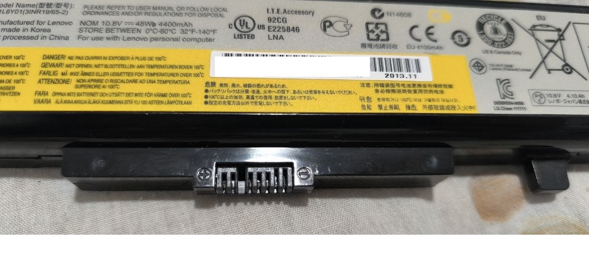
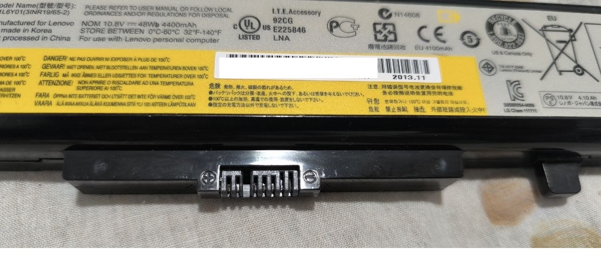
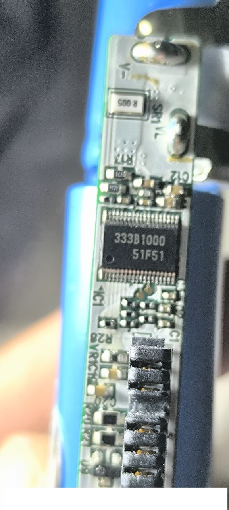
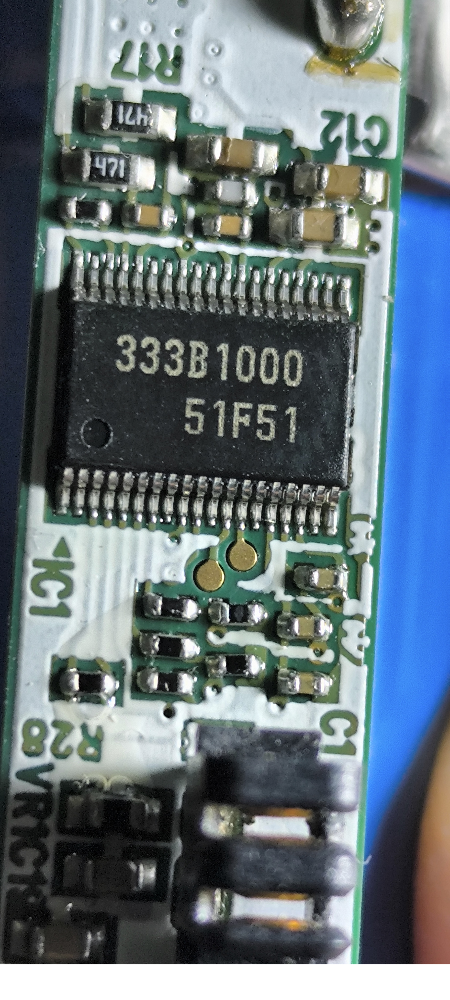
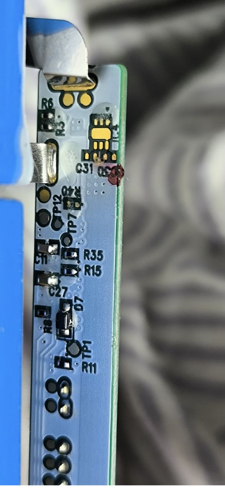
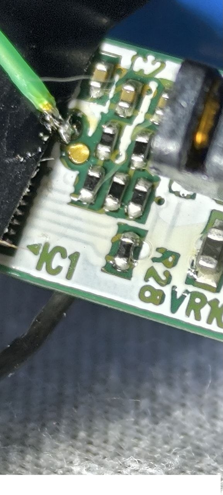
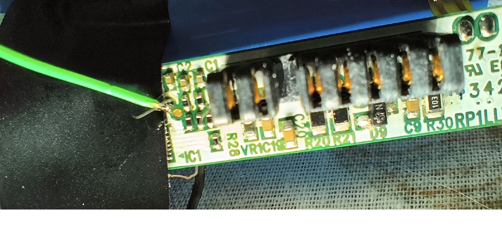

# Разблокировка батареи Lenovo L11L6Y01 (LGC, Renesas 51F51) с помощью Raspberry Pi

**Русский** | [English](README.md)

Это опыт восстановления одной заблокированной батареи. Покупать ничего не нужно: хватит Raspberry Pi,
мультиметра, паяльника и двух резисторов. Программатор (FX2LP, CP2112, EZP) не нужен.

> **Внимание.** Литий-ионная батарея опасна при неправильном обращении. Всё ниже вы делаете
> на свой риск. Разблокировка **не чинит изношенные ячейки**, она только снимает программный запрет.
> Если ячейки разбалансированы или одна из групп ниже ~3.0 В, сначала разберитесь с ячейками.

---

## 1. Симптомы

- Ноутбук видит батарею, но **не заряжает**: 0 %, `Not charging` / `pending-charge`.
- В другом ноутбуке то же самое. **Проверьте это первым делом**: так сразу видно, что виновата батарея.
- Раскачка внешним источником, долгое ожидание на зарядке и сброс EC **не помогают**.

Вывод `upower` до ремонта:

```
$ upower -i /org/freedesktop/UPower/devices/battery_BAT0
  vendor:               LGC
  model:                L11L6Y01
  state:                pending-charge
  energy:               0 Wh
  energy-full:          32.99 Wh
  energy-full-design:   47.52 Wh
  voltage:              10.208 V
  percentage:           0%
```

Причина: контроллер батареи записал во флеш флаг блокировки (Permanent Failure) после долгого
глубокого разряда. После этого он **сам запрашивает у ноутбука 0 мА и 0 мВ**.

---

## 2. Батарея

| Параметр | Значение |
|---|---|
| Модель | **Lenovo L11L6Y01** (3INR19/65-2), P/N 121500042 |
| Производитель | LGC (LG Chem) |
| Номинал | 10.8 В, 48 Вт·ч, 4400 мАч, 3S2P, ячейки 18650 |
| Ноутбуки | IdeaPad G480/G580, Z480/Z580, Y480/Y580, G500/G505/G510, G700/G710 |
| Родственные модели (не проверялись) | L11S6Y01, L11M6Y01, L11L6F01, L11P6R01 |
| **Контроллер** | **Renesas R2J240, вариант «51F51»**, корпус TSSOP-38, маркировка `333B1000 / 51F51` |



**Это не TI bq-чип.** Ключи Unseal от Texas Instruments (`0x0414/0x3672` и т.п.) и «Clear PF через
ManufacturerAccess» здесь **не работают**. Флаг снимается только правкой флеша через встроенный бутлоадер.

### Разъём (7 контактов)

Смотреть на разъём, этикетка сверху. Слева на корпусе значок ⊕, справа ⊖.

```
 ⊕ [1][2] ▮ [3][4][5][6][7] ⊖
   B+  B+ ключ CLK DAT T/ID B− B−
```

| Контакт | Сигнал | Проверено |
|---|---|---|
| 1, 2 | B+ (~10–12.6 В) | мультиметром |
| 3 | **SMBCLK** | обменом с Pi |
| 4 | **SMBDAT** | обменом с Pi |
| 5 | термистор / ID (~10 кОм до B−) | мультиметром |
| 6, 7 | B− | мультиметром |



На линиях SMBus **нет подтяжки к напряжению пака**: на отключённой батарее там 0 В, а до B− ~10 кОм.
Поэтому их можно подключать прямо к GPIO Raspberry Pi (3.3 В) без преобразователя уровней.

---

## 3. Что понадобится

| Что | Зачем |
|---|---|
| Raspberry Pi (проверено на **Pi 3 Model B**) | программный SMBus и доступ к бутлоадеру |
| **Пауэрбанк** 5 В / 2 А для питания Pi | **обязательно**: от сетевого блока питания были помехи, и запись срывалась |
| Мультиметр | проверка точек и ячеек |
| Паяльник, тонкий провод (МГТФ) | подпаять провода к TP1 и RESET |
| **2 резистора по 1 кОм** | для BOOT и RESET |
| 3 провода «мама» | разъём батареи → GPIO |

### Система на Pi (на момент написания)

```
$ uname -a
Linux rpi3 7.1.6-1-aarch64-ARCH #1 SMP PREEMPT_DYNAMIC Wed Aug  5 00:20:13 UTC 2026 aarch64 GNU/Linux
```

- **Arch Linux ARM (aarch64)**, пользователь `alarm`, `sudo` настроен.
- Нужен только `python3` из базовой системы. **`smbus2`, `i2c-tools` и интернет не нужны.**
- Скрипт работает напрямую с регистрами GPIO через `/dev/mem`, поэтому запускается от root.

На другом дистрибутиве (Raspberry Pi OS и т.д.) должно работать так же. Для Pi 4 укажите
`--peri-base 0xFE000000`.

---

## 4. Подключение к Raspberry Pi

```
Батарея                 Raspberry Pi (40-pin)
─────────               ─────────────────────
контакт 4 (SMBDAT) ───► Pin 3  (GPIO2 / SDA)
контакт 3 (SMBCLK) ───► Pin 5  (GPIO3 / SCL)
контакт 7 (B−)     ───► Pin 6  (GND)
контакты 1,2 (B+)       НЕ подключать
контакт 5               НЕ подключать
```

- Рядом с Pin 3 стоят Pin 2 и Pin 4 (5 В). **Переставляйте провода только при выключенной Pi**:
  один раз Pi перезагрузилась от случайного касания.
- Pi питать **от пауэрбанка**.

### Почему не аппаратный I2C

Аппаратный I2C у BCM2835/2837 (Pi 1/2/3) **неправильно обрабатывает clock stretching**,
а контроллер батареи постоянно им пользуется. С аппаратным I2C адрес `0x0B` виден в `i2cdetect`,
но регистры читаются как `0xFFFF` или с ошибками. Поэтому `r2j240.py` использует **программный I2C**
на тех же пинах GPIO2/3 и сам на время работы отключает драйвер ядра.

---

## 5. Шаг 1 — диагностика (только чтение)

Скопировать `tools/r2j240.py` на Pi и запустить:

```
$ sudo python3 r2j240.py sbs
```

Вывод **до ремонта** (основное):

```
[0x09] Voltage             : 10208 mV (10.208 V)
[0x0D] RelativeSOC         : 0 %
[0x10] FullChargeCapacity  : 3299 10mWh
[0x14] ChargingCurrent     : 0 mA
[0x15] ChargingVoltage     : 0 mV (0.000 V)
[0x16] BatteryStatus       : 0x0290
[0x17] CycleCount          : 630
=== Verdict ===
  ChargingCurrent=0 mA, ChargingVoltage=0 mV -> PACK BLOCKS CHARGING (locked)
```

Нули в `0x14` и `0x15` — это и есть блокировка: пак сам запрещает зарядку.
Флаги в `0x16` (`FD`, `RCA`, `INIT`) означают только «пустой», флага PF стандартный SBS тут не показывает.

---

## 6. Шаг 2 — вскрыть пак и найти точки

Корпус склеен. Аккуратно вскрыть по шву. **Ячейки и провода от них к плате не трогать.**

### Лицевая сторона: контроллер




Чип `51F51` (TSSOP-38). Точка-ключ отмечает ножку 1. Нужные ножки:

| Ножка | Сигнал | Напряжение в покое (на V−) |
|---|---|---|
| 3 | VCC | 3.3 В |
| 10 | **BOOT** (активный 0) | 3.3 В |
| 12 | аналоговый сигнал, **не трогать** | 1.61 В |
| 13 | **RESET** (активный 0) | 3.3 В |

Под чипом, со стороны разъёма, две круглые золотые площадки. Они идут к **ножкам 12 и 13**.
Для RESET используется площадка **ножки 13**.

### Обратная сторона: TP1 = BOOT



**TP1** — круглая площадка у резистора R11, под диодом D7. Это **BOOT** (ножка 10).
Проверка: на TP1 относительно V− должно быть 3.3 В, и TP1 должна прозваниваться с ножкой 10.

Точка **V−** (земля контроллера) — площадка с надписью `V-` у шунта `R005`.

---

## 7. Шаг 3 — подпаять провода

**На время пайки отключить провода к Pi** (иначе земля паяльника через розетку замкнётся с землёй
батареи через Pi и Мак). Ячейки при этом **не отключать**: контроллер должен оставаться под питанием.

```
TP1        ───[1 кОм]───○ BOOT  (свободный конец)
ножка 13   ───[1 кОм]───○ RESET (свободный конец)
V−         ─────────────○ ЗЕМЛЯ
```

- Нужны **два отдельных** резистора: BOOT и RESET отпускаются в разное время.
- Жало 300–330 °C, касание не дольше 2–3 с, флюс без кислоты.
- После пайки проверить: TP1 = 3.3 В, ножка 13 = 3.3 В, ножка 12 = 1.61 В. Значит, перемычек нет.
- Свободные концы **заизолировать**. Если RESET случайно касается земли, контроллер всё время
  перезагружается, и связь «разваливается».

Провод RESET припаян к площадке ножки 13 (вторая золотая площадка, ножка 12, остаётся свободной):




После пайки снова подключить провода к Pi и проверить, что плата живая:

```
$ sudo python3 r2j240.py mode
Firmware is running (DeviceChemistry = LION). Not in Boot ROM.
```

---

## 8. Шаг 4 — войти в бутлоадер

Порядок важен:

| # | Действие |
|---|---|
| 1 | BOOT коснуть V− и **держать** |
| 2 | RESET коснуть V− |
| 3 | подождать 1 секунду |
| 4 | **RESET отпустить** (BOOT всё ещё на земле) |
| 5 | подождать 2 секунды |
| 6 | BOOT отпустить |

Проверка:

```
$ sudo python3 r2j240.py mode
BOOT ROM ACTIVE. DF3 @0xC040: 00 00 00 4c 31 31 4c 36 59 30 31 00 00 00 00 00 | ...L11L6Y01..... |
```

Строка `L11L6Y01` из флеша означает, что бутлоадер работает и память читается.

Если связь нестабильная (то работает, то нет), почти наверняка это **помехи от сетевого
блока питания**. Переведите Pi на пауэрбанк, отключите USB-UART адаптер и работайте по Wi-Fi/SSH.

---

## 9. Шаг 5 — снять дампы (только чтение)

```
$ sudo python3 r2j240.py dump all -o backup1
dumping df1 0x03000..0x033FF ...
  saved backup1/df1.bin  md5=9719294932b802e3b1d0f963411916c1
dumping df2 0x03400..0x037FF ...
  saved backup1/df2.bin  md5=9a8918b11878da506f761bc1c9c4ce17
dumping df3 0x0C000..0x0DFFF ...
  saved backup1/df3.bin  md5=320d7f9d99f537f96649036a7a7ece2e

$ sudo python3 r2j240.py dump df1 -o backup2
$ md5sum backup1/df1.bin backup2/df1.bin      # должны совпасть
```

| Область | Адрес | Размер | Содержимое |
|---|---|---|---|
| DF1 | 0x3000 | 1 КБ | **динамические данные, журнал, флаг блокировки** (без контрольной суммы) |
| DF2 | 0x3400 | 1 КБ | у этого пака пустая (FF) |
| DF3 | 0xC000 | 8 КБ | статические данные (имя, ёмкость), **с контрольной суммой, не трогать** |

**Сохраните дампы в нескольких местах** до любой записи.

---

## 10. Шаг 6 — найти и исправить флаг

```
$ python3 patch_df1.py backup1/df1.bin df1_fixed.bin
log entries (leading 0x00 bytes): 2
entry 0 @0x040: BatteryMode=0xE000 FCC=32990 mWh Cycles=630 flag@0x06B=0x16
entry 1 @0x090: BatteryMode=0xE000 FCC=32990 mWh Cycles=630 flag@0x0BB=0x17
patched offsets: 0x06B, 0x0BB -> df1_fixed.bin
```

Как это устроено:

```
00000000: 0000 ffff ffff ...                      ← "00 00" = 2 записи журнала
00000010: 4c31 314c 3659 3031 ...                 ← L11L6Y01
00000040: b801 db01 0a00 00e0 e30c f50a 7602 ...  ← запись 0: BatteryMode E000, FCC 0CE3, Cycles 0276
00000060: 0000 0000 0000 0060 93f5 01[16] 0101 ...← запись 0, флаг @0x6B = 0x16
00000090: b801 db01 0a00 00e0 e30c f50a 7602 ...  ← запись 1
000000b0: 0000 0000 0000 0060 93f5 01[17] 6001 ...← запись 1, флаг @0xBB = 0x17
```

- `0x16` / `0x17` (бит 4 = блокировка) → **`0x03`**.
- **Не `0x00`**: по отзывам, с нулём пак отключается через несколько секунд.
- Меняются **только эти 2 байта**, больше ничего.

Если у вашей батареи разметка другая, `patch_df1.py` остановится и ничего не запишет.
Тогда сравнивайте свой дамп с примером из `dumps/` вручную.

---

## 11. Шаг 7 — записать и запустить

```
$ sudo python3 r2j240.py write df1 df1_fixed.bin --expect backup1/df1.bin --confirm
precheck: reading current DF1 ...
erase 0x3000 ...
erase OK
write ...
readback md5 26b20b0f8bf877f9b4ef745ef5b2599d  target md5 26b20b0f8bf877f9b4ef745ef5b2599d
VERIFY OK

$ sudo python3 r2j240.py execute
execute sent, firmware should start now
```

Что делает `write`:
1. Читает DF1 и сверяет с `--expect`. Если не совпадает, **ничего не стирает**.
2. Стирает блок, проверяет, что он пустой.
3. Записывает и сверяет чтением.

Бутлоадер находится в ПЗУ, стереть его нельзя. Если запись сорвалась, войдите в бутлоадер
снова и повторите `write`: блок пустой (`FF`) тоже допускается как исходное состояние.

### Проверка

```
$ sudo python3 r2j240.py sbs
[0x14] ChargingCurrent     : 2800 mA
[0x15] ChargingVoltage     : 12600 mV (12.600 V)
=== Verdict ===
  ChargingCurrent=2800 mA, ChargingVoltage=12600 mV -> pack requests charge (OK)
```

**Было 0 / 0, стало 2800 мА / 12600 мВ.** Пак снова просит заряд.

---

## 12. Шаг 8 — ячейки, сборка, первая зарядка

1. Измерить **каждую из 3 групп** (B−→T1, T1→T2, T2→B+):

   | Группа | Пример (этот пак) |
   |---|---|
   | 1 | 3.40 В |
   | 2 | 3.42 В |
   | 3 | 3.42 В |

   - разница **до 0.1 В** и все **выше 3.0 В**: можно заряжать;
   - перекос: подзарядить отстающую группу отдельно (лабораторный БП, напряжение = как у остальных, 0.3–0.5 А);
   - группа ниже ~2.5 В или проседает за сутки: **менять ячейки**.
2. Отпаять или заизолировать провода TP1/RESET, собрать корпус.
3. Вставить в ноутбук, подключить БП:

   ```
   $ cat /sys/class/power_supply/BAT0/status
   Charging
   $ upower -i /org/freedesktop/UPower/devices/battery_BAT0 | grep -E "state|percentage|energy-rate|voltage"
       state:               charging
       voltage:             11.34 V
       energy-rate:         25.333 W
       percentage:          10%
   ```

4. Первая зарядка **под присмотром**, на негорючей поверхности. Горячий корпус — сразу отключить.

   Примерно через 40 минут (ноутбук включён, ток ~2.7 А):

   ```
   $ upower -i /org/freedesktop/UPower/devices/battery_BAT0
       state:               charging
       energy:              23.63 Wh
       energy-full:         28.05 Wh
       energy-full-design:  47.52 Wh
       energy-rate:         32.083 W
       voltage:             11.927 V
       time to full:        8.2 minutes
       percentage:          84%
       capacity:            59.0278%
   ```

   Когда пошёл реальный заряд, контроллер пересчитал полную ёмкость:
   32.99 Вт·ч → **28.05 Вт·ч (59 % от номинала)**. Это реальное состояние ячеек
   (630 циклов и долгий глубокий разряд); калибровка уточнит значение.
5. После полной зарядки сделать калибровку: полный разряд и снова полный заряд.

Ячейки изношены (630 циклов, ~59 % ёмкости). Батарея работает, но держит примерно
от половины до двух третей от новой.

---

## 13. Проблемы и решения

| Симптом | Причина | Решение |
|---|---|---|
| `0x0B` виден в `i2cdetect`, регистры `0xFFFF` / N/A | аппаратный I2C Pi и clock stretching | использовать `r2j240.py` (программный I2C) |
| Через раз NACK, биты «плывут», бутлоадер то отвечает, то нет | помехи от сетевого БП / земляная петля | **Pi от пауэрбанка**, отключить USB-UART, работать по SSH/Wi-Fi |
| После перестановки проводов Pi перезагрузилась | задели 5 В на Pin 2/4 | переставлять провода только при выключенной Pi |
| Связь пропала после пайки | свободный конец RESET касается земли | заизолировать концы BOOT/RESET |
| Многострочная вставка в `screen` по UART склеивает команды | особенность UART-консоли | вставлять по одной строке или работать по SSH |
| `mode`: «No firmware answer and no Boot ROM answer» | плохой контакт, помехи, чип в сбросе | проверить провода, питание, снова войти в бутлоадер |

---

## 14. Благодарности и источники

Без чужих исследований эта работа была бы невозможна. Перечислены только источники, которые
реально использовались.

### Основные источники

| Источник | Что взято |
|---|---|
| **Viktor (karosium)**, «Hacking the R2J240 with LGC firmware»<br><https://www.karosium.com/2016/08/hacking-r2j240-lgc.html> | контроллер — Renesas R2J240; ножка BOOT и TP1; области флеша DF1/DF2/DF3; в DF1 нет контрольной суммы; число записей журнала = число байтов `0x00` в начале |
| **Viktor (karosium)**, `smbusb_r2j240flasher.c`<br><https://github.com/karosium/smbusb/blob/master/tools/smbusb_r2j240flasher.c> | протокол бутлоадера: чтение `0xFC`, запись `0xFD`, стирание `0x20`, запуск `0x00 = 0xD001`; адреса и размеры областей. `r2j240.py` повторяет этот протокол |
| **Viktor (karosium)**, проект SMBusb<br><https://github.com/karosium/smbusb>, <https://www.karosium.com/p/smbusb.html> | исходный USB-инструмент для SMBus (FX2LP), от которого идёт весь подход |
| **Viktor (karosium)**, «SMBusb - Hacking smart batteries»<br><http://www.karosium.com/2016/08/smbusb-hacking-smart-batteries.html> | общий метод: дамп, поиск флага ошибки, перезапись |

### Комментарии к статье karosium про R2J240

| Автор | Вклад |
|---|---|
| **h4tr3d** | 51F51 = R2J240 в корпусе TSSOP-38; **ножка 10 = BOOT, ножка 13 = RESET**, ножка 3 = VCC; BOOT выведен на TP1; байт блокировки `0x17 → 0x03` возвращает ChargingCurrent/Voltage из нулей в нормальные значения. Порт инструментов под i2c-dev: <https://github.com/h4tr3d/smbusb> |
| **ladislav** | разметка DF1 у пака LGC: флаги блокировки по `0x6B` (`0x17` заблокировано, `0x03` норма), `0x46` BatteryMode, `0x48` FCC, `0x4C` CycleCount |
| **Man-Eating Monkey** | последовательность BOOT/RESET; **писать `0x03`, а не `0x00`** (с `0x00` пак отключается через несколько секунд) |
| **Вета** | подтверждение, что TP1 — точка входа в бутлоадер на паках LGC с 51F51 |
| **0r10nV** | как найти флаг PF: сравнить дампы до и после сбоя |
| **burgekin** | для входа в бутлоадер может понадобиться подать питание с уже прижатыми BOOT/RESET |

### Прочее

| Источник | Что взято |
|---|---|
| Распиновка батарей ThinkPad, PinoutGuide<br><https://pinoutguide.com/Power/thinkpad_battery_pinout.shtml> | в паках Lenovo **нет внутренних подтяжек на SMBus**; термистор — NTC 10 кОм на GND |
| laptopu.ro, распиновка L11L6Y01<br><https://www.laptopu.ro/community/pinputs-for-ibm-lenovo-batteries/l11l6y01-3inr19-65-2-battery-pinout/> | у L11L6Y01 та же распиновка, что у L11S6Y01 / L09S6Y01 |
| **Viktor (karosium)**, блог, сентябрь 2016<br><http://www.karosium.com/2016/09/> | заметки о термопредохранителе в смарт-батареях |

Всё, что относится именно к этой батарее (распиновка разъёма, площадки ножек 12/13, смещения
`0x6B`/`0xBB` в DF1, проблема с сетевыми помехами и решение через пауэрбанк, программный I2C на Pi),
проверено вручную во время этого ремонта.

---

## Содержимое репозитория

```
tools/r2j240.py        программный SMBus для Raspberry Pi: sbs / mode / dump / write / execute
tools/patch_df1.py     офлайн-поиск и исправление флага блокировки в дампе DF1
dumps/                 реальные дампы этой батареи (до и после) для сравнения
images/                фотографии этикетки, разъёма и платы
```

**Статус проверки.** Весь процесс выполнен на одной батарее L11L6Y01 с Raspberry Pi 3B. Обмен с
батареей шёл через отладочные скрипты, `r2j240.py` собран из них в один инструмент и **на железе
целиком ещё не прогонялся**. `patch_df1.py` проверен на реальном дампе: результат совпал с
записанным файлом байт в байт.

## Лицензия

Код — MIT. Текст — CC BY 4.0.
